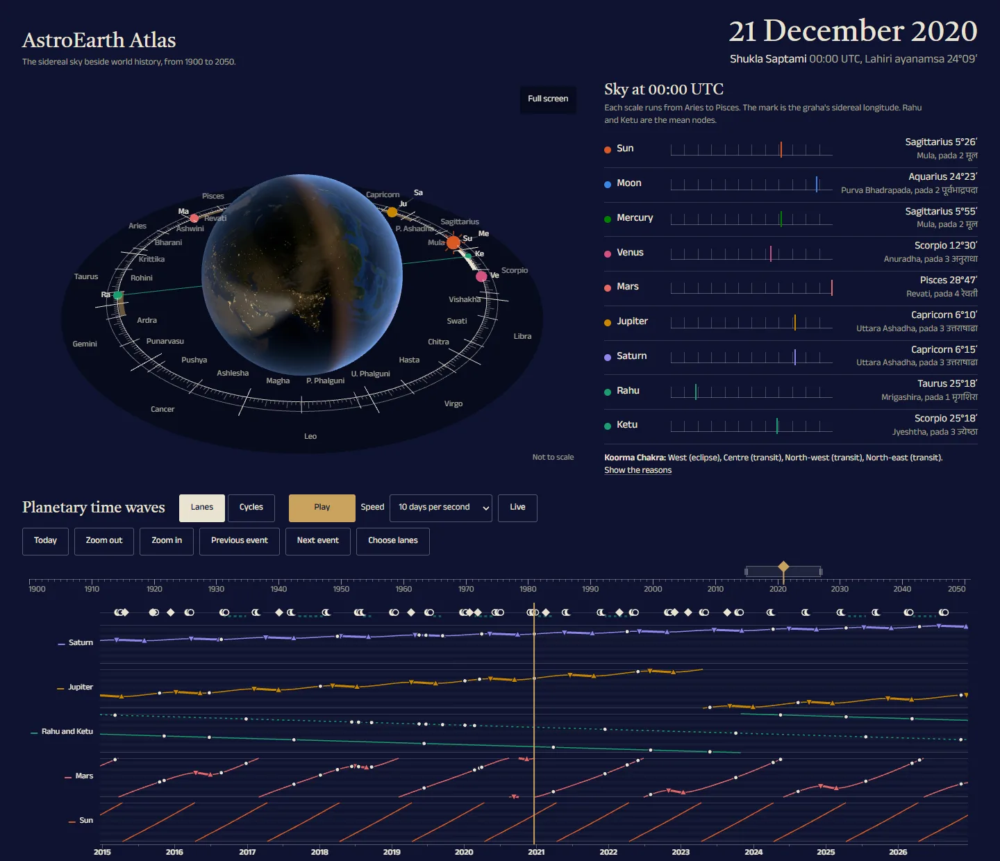

# AstroEarth Atlas

An interactive 3D Earth and planetary time waves for Vedic mundane astrology
(Medini Jyotisha). It shows the sidereal sky (Lahiri) from 1900 to 2050 beside
dated world events, and maps the Koorma Chakra of the Brihat Samhita onto the
globe.

> **Status:** version 1.0. Live at
> [diprajkadlag.github.io/astroearth-atlas](https://diprajkadlag.github.io/astroearth-atlas/).



*21 December 2020, the day of the great conjunction in Capricorn. The west of
the Koorma Chakra glows for the solar eclipse of 14 December in Jyeshtha.
Earth images: NASA.*

## What you can do

- Move the date with the ruler. The nakshatra ring, the Earth and the
  planetary time waves follow it.
- Read the sky table: the sign, degree, nakshatra and pada of the 9 grahas, in
  the Lahiri sidereal zodiac.
- Open world events, eclipses and the conjunctions of Jupiter and Saturn on
  the timeline. Each card gives the facts of the event.
- See the Koorma Chakra of the Brihat Samhita on the globe: in its classical
  form around Mathura, or as a modern extension over half of the Earth.
- Compare the great conjunctions from 1000 to 2100 in the sidereal and the
  tropical zodiac.

## What it is, and what it is not

AstroEarth Atlas shows calculated sky positions and traditional Jyotish rules. It
does not predict events. It is not financial, medical, legal or safety advice.

The site makes no request to any other server: fonts, textures and data ship
with it, and there are no cookies, accounts or analytics.

## Development

Requirements: Node.js 24 (see `.nvmrc`) and npm 11.

```bash
npm install
npm run dev        # http://localhost:4747
```

Checks (the same ones that CI runs):

```bash
npm run typecheck
npm run lint
npm test
npm run build
npm run licenses   # production licenses and THIRD_PARTY_NOTICES.md
npm run data:check # precomputed sky data matches the engine
npm run e2e        # browser checks against the built site (port 4748)
npm run release-check # after a build: no [TODO] marker left in the legal pages
```

The first `npm run e2e` needs a browser: `npx playwright install chromium`.

After a change to `src/engine/`, regenerate the precomputed sky data with
`npm run data` (about 10 seconds). `docs/METHOD.md` states every convention
and how it was checked, including a comparison with NASA JPL Horizons.

## Credits

- Inspired in part by public talks on mundane astrology, including talks by
  Abhigya Anand. AstroEarth Atlas is an independent hobby project. It is not
  affiliated with, sponsored, endorsed or reviewed by Abhigya Anand. All data,
  calculations and interpretations are the author's own.
- Textures, fonts and data: see [CREDITS.md](CREDITS.md).
- Open-source libraries: see [THIRD_PARTY_NOTICES.md](THIRD_PARTY_NOTICES.md).

## License

The source code is available under the [MIT License](LICENSE). Assets and data
keep their own licenses, listed in [CREDITS.md](CREDITS.md).
